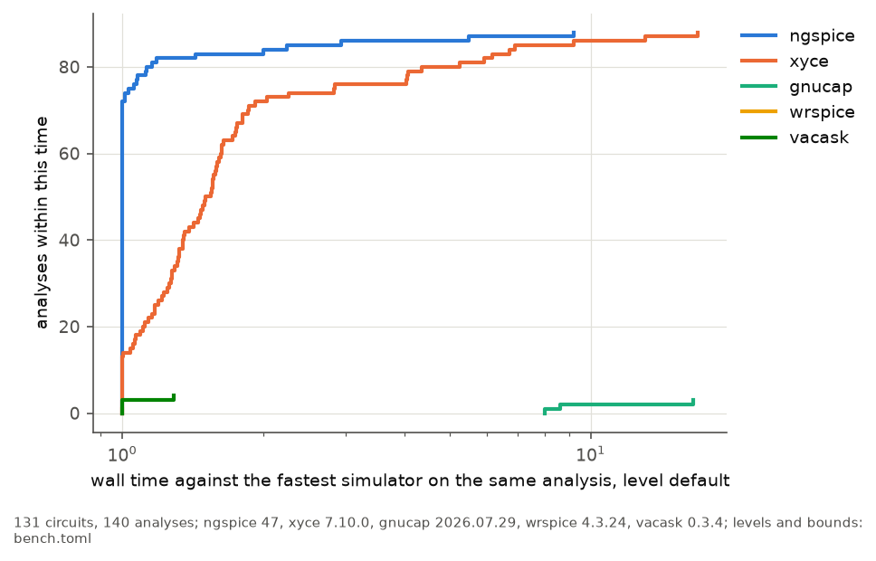

# Circuit Reference Suite

Circuit netlists with every device model they need, for benchmarking circuit
simulators against each other under the same conditions. A circuit
(`circuits/<name>.toml`) states what is computed, independent of any simulator;
adapters write it in each simulator's dialect. Upstream files are committed byte
for byte and hash-checked. License per case and library.





## Layout

```
circuits/<name>.toml         a circuit: body netlist, analyses, signals, options
cases/<id>/case.toml         source, files with sha256, netlists and dialects, resolve table
libraries/<id>/library.toml  model libraries shared by cases (PDK models, Verilog-A)
sims/<simulator>.sh          builds a simulator, newest release (sims/common.sh)
bench.toml                   precision levels, comparison bounds, plot style
index.csv                    one row of properties per circuit (circref/classify.py), generated
studies/<name>.toml          a filter over index.csv and the parameters of its run
```

## Usage

```
pip install -e .
python -m circref check                  # schema, hashes, references, generated READMEs
python -m circref select "m >= 1 and devices <= 1000 and 'tran' in analyses"
python -m circref run --out OUT [filter] [--sim S] [--level L]
python -m circref run --out OUT --study studies/generated.toml
python -m circref compare OUT            # OUT/compare.json, OUT/plots/
```
